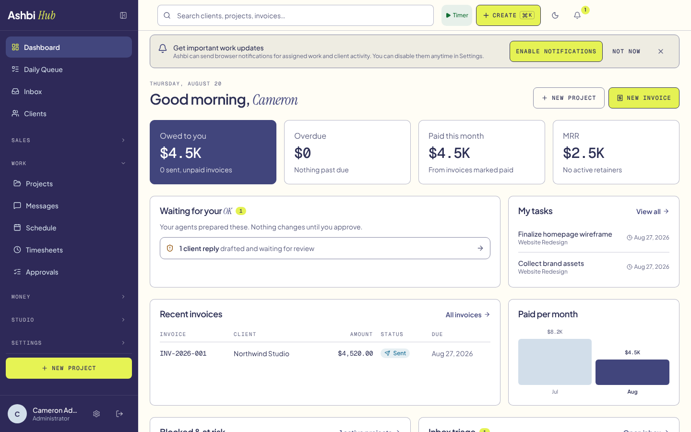
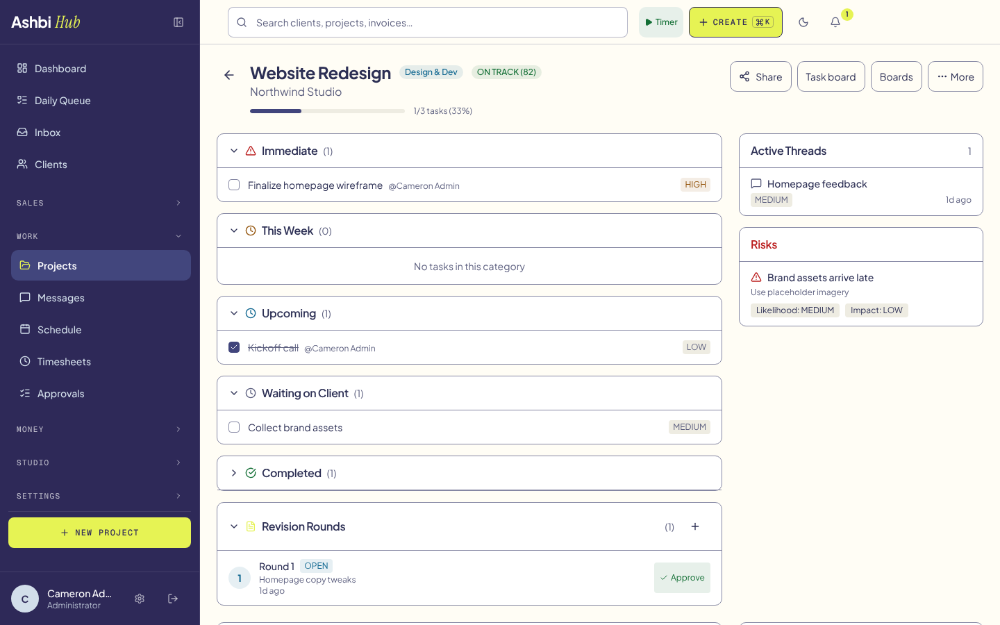

# Ashbi Hub

An all-in-one operations platform for a small creative agency: clients, projects, tasks, time, finance documents, team chat, media review and a client portal in one self-hosted app.

It is Ashbi Design's internal tool. This repository holds two apps:

- The existing **Hub** (`src/`, `web/`, `prisma/`). The feature list and root
  commands below describe this app. It is now the fallback app and still provides
  sign-in for the workspace.
- The **Cloudflare workspace** in [apps/workspace](apps/workspace/README.md), which the
  owner selected for daily use. It has its own dependencies, commands and tests.

## Status

Both apps are built. [Deployment and rollback](docs/deployment-and-rollback.md)
records the workspace selection and the last recorded Hub release. Authenticated
daily-use acceptance, live billing (workspace Stripe is documented as test mode) and
retirement of the Hub are recorded as separate and not established by deployment.
Many Hub features are in the code but not verified in production; check
[product status](docs/product-status.md) and [launch status](docs/launch-status.md)
per feature. The product is not yet proven as a general-market replacement.

On 27 October 2026, the owner closed the remaining issues and pull requests.
Their references in planning documents preserve history and do not prove
completion. Local cleanup evidence is in the
[feature cleanup inventory](docs/feature-cleanup-inventory.md).

LLM integrations use the provider-free [workspace HTTP API and MCP tools](docs/workspace-api-mcp.md).
Embedded assistance is optional and hidden by default. A generated
[GPT Actions schema](docs/workspace-actions.openapi.json) is available for API-key clients.



## Why

Ashbi Design runs its client work across many separate tools (task boards, wikis, chat, screen recordings, design review, invoicing). Ashbi Hub brings that work into one multi-tenant app with a single permission model, an audit trail and a client-facing portal, so staff and clients see the same source of truth. It is built in-house; the dated, per-feature status lives in [docs/product-status.md](docs/product-status.md).

## Key features

These are present in the Hub source. See the status section for what has been verified.

- **Clients and CRM**: client records with contacts, health tracking, sales pipeline and intake forms.
- **Projects and tasks**: task lists and kanban boards, milestones, project templates, a project planner, and a daily operator queue that sorts open work into *Needs action*, *Awaiting approval*, *Waiting on client* and *At risk*.
- **Time tracking**: one running timer per user, manual entries, timesheets, approvals and locking of approved or invoiced time.
- **Finance documents**: proposals, contracts, estimates, invoices (per-organization numbering, Stripe checkout), expenses, retainers, rate cards and overdue invoice reminders.
- **Client portal**: clients sign in to see their own projects, shared files, reviews, invoices and proposals. Portal sessions are revoked immediately when a client is paused or a contact is removed, and internal data (budgets, AI summaries, risks) never reaches it.
- **Team chat with media**: per-project conversations where each message is *Internal* or *Visible to client*, with pasted screenshots, screenshot markup, and in-browser screen and camera recordings.
- **Media review**: review sessions over images, PDFs, video and recordings with pin, area, arrow and freehand markup, timestamped comments, versioning, client approval decisions and exportable evidence.
- **Docs and inbox**: a project wiki, an email inbox with threaded replies through a connected Gmail mailbox, and global search and optional semantic search.
- **Governed AI** (embedded features are hidden unless `VITE_EMBEDDED_AI_ENABLED=true` at build time): Claude, Gemini or Ollama for summaries and drafting; an organization-level bring-your-own-key option with monthly budgets and kill switches; and an AI tool registry where anything that would change data becomes a pending action that a human approves.
- **Security and administration**: roles and tenancy, TOTP two-factor (enforceable per organization), step-up confirmation for sensitive actions, audited read-only support impersonation, an encrypted credential vault, upload validation policy and an append-only audit log.
- **Migration importers**: dry-run-first CLI importers for Notion, Slack, Loom, MarkUp.io, Bonsai and ClickUp exports, with reconciliation reports and rollback by run id where supported.
- **PWA**: installable web app with offline support for the public shell only. Private API data is never cached on the device.



## Tech stack

- **Frontend**: React 19, Vite 8, React Router 7, TanStack Query, Tailwind CSS 4, Socket.IO client, pdf.js
- **Backend**: Node.js 24 LTS, Fastify 5, Prisma 7, Zod 4 validation, Socket.IO with a Redis adapter
- **Data**: PostgreSQL 18 with pgvector and Redis 8 for new installations; existing production data services require the separately rehearsed upgrade in [the deployment guide](docs/coolify-deployment.md)
- **Jobs**: BullMQ worker process
- **AI**: Anthropic Claude SDK, Google Gemini, Ollama, OpenAI-compatible providers (BYOK)
- **Integrations**: Stripe, Mailgun, Gmail and Google Calendar (googleapis), Slack, web push
- **Observability**: OpenTelemetry tracing, Sentry, pino logging
- **Quality**: TypeScript 7 native type checking (`tsc --noEmit`), with Microsoft's TypeScript 6 API compatibility package for ESLint, ESLint, Node test runner, Vitest, Testing Library, Playwright (with axe accessibility checks), Lighthouse CI, CodeQL
- **Packaging**: Docker and Docker Compose

## Getting started

Prerequisites: Node.js 24.22.0 (see `.nvmrc`), PostgreSQL with pgvector, and Redis. The development and fresh-install Compose files use PostgreSQL 18 and Redis 8. Existing installations must follow the [data upgrade procedure](docs/coolify-deployment.md) before switching database images.

Tailwind CSS 4 requires Safari 16.4+, Chrome 111+, or Firefox 128+.

```bash
# Use the pinned Node version (if you use nvm)
nvm use

# Install backend and frontend dependencies
npm ci
npm ci --prefix web

# Create a local environment file from the template, then fill in the placeholders
cp .env.example .env

# Apply the committed migrations and generate the Prisma client
npx prisma migrate deploy
npm run db:generate

# The backend does not load .env on its own; export it into each backend/worker shell
set -a; source .env; set +a

# Start the API, the web app and the background worker (separate terminals)
npm run dev
npm run dev:web
npm run dev:worker
```

The API listens on `http://localhost:3000` and Vite serves the app on `http://localhost:5173`, proxying API and socket traffic. Create the first administrator with `POST /api/auth/register` using the `ADMIN_INVITE_TOKEN` you set in your local `.env`.

Prefer containers? `docker compose -f docker-compose.yml -f docker-compose.dev.yml up` runs the app, worker, PostgreSQL (pgvector) and Redis, with database and cache ports published to your machine for local tools. The containerized app is on `http://localhost:3002`. Compose also needs `DB_PASSWORD`.

### Environment variables

[.env.example](.env.example) lists most names. The main ones:

| Variable | Use |
|---|---|
| `DATABASE_URL`, `REDIS_URL` | PostgreSQL and Redis connections |
| `JWT_SECRET`, `CREDENTIALS_KEY` | Sessions and credential vault; startup fails without them in staging and production |
| `ADMIN_INVITE_TOKEN` | First administrator registration |
| `NODE_ENV`, `PORT`, `CORS_ORIGIN`, `APP_URL`, `PORTAL_BASE_URL` | Runtime and URLs |
| `STRIPE_*`, `MAILGUN_*`, `GMAIL_*`, `GOOGLE_CALENDAR_*`, `SLACK_*`, `VAPID_*` | Integrations |
| `ANTHROPIC_API_KEY`, `GEMINI_API_KEY`, `OLLAMA_*`, `AI_DISABLED` | AI providers and kill switch |
| `SENTRY_DSN`, `OTLP_ENDPOINT` | Observability |

### Database changes

Use `prisma db push` only against a disposable local database. Shared environments always use the committed migration chain.

## Testing

Before `verify`, `verify:release` or `test:integration`, provision and select a
[disposable local test database](docs/local-verification.md). The development
`ashbihub` connection is not a safe test target. `verify:quick` needs no database.

```bash
npm run test:core       # about 100 focused API and rendered UI tests for daily work
npm run verify:quick    # package boundaries, typecheck, lint, backend and frontend unit tests
npm run verify          # verify:quick plus integration tests and a production build
npm run verify:browser  # Playwright browser, public-route and PWA offline checks
npm run verify:release  # verify plus Lighthouse and release-policy checks
```

The core suite covers sessions, tenant isolation, client/project/task flows,
time locks, invoice saves/billing, uploads and document recovery. Its selected
files and limits are documented in [local verification](docs/local-verification.md).
The full regression, integration and browser suites remain the release checks.

Full-stack end-to-end tests (PostgreSQL, Redis, worker and API in Docker):

```bash
npm run test:e2e:setup
npm run test:e2e
npm run test:e2e:teardown
```

The workspace has separate tests; run them from `apps/workspace` (see [its README](apps/workspace/README.md#local-checks)).

Install browsers for Playwright once with `npx playwright install --with-deps chromium firefox webkit`. Visual regression baselines run with `npm run test:visual` (see [docs/visual-baselines.md](docs/visual-baselines.md)).

## Project structure

```
src/            Fastify backend
  domains/      route registrars grouped by domain (identity, revenue, client delivery, ...)
  routes/       API route modules
  services/     business logic
  ai/           AI providers and the governed tool registry
  agents/       AI agent modules
  auth/         sessions, MFA, step-up, OAuth and socket authentication
  jobs/         BullMQ worker and background jobs
  realtime/     Socket.IO rooms and events
  security/     upload, outbound URL and Slack event policies
  tests/        unit, integration and AI evaluation suites
web/            React + Vite frontend (pages, components, hooks)
prisma/         schema and committed migrations
scripts/        importers, generators and maintenance CLIs
tests/          Playwright browser, accessibility, PWA and visual tests
apps/workspace/ Cloudflare workspace (own package and checks)
prototypes/     Earlier isolated runtime proofs
upwork-agent/   Separate Upwork sync scripts (own package)
docs/           design and reference documentation
```

The backend's composition and domain boundaries are described in [docs/backend-application-boundaries.md](docs/backend-application-boundaries.md).

## Production

[docs/deployment-and-rollback.md](docs/deployment-and-rollback.md) is the authority for both apps.

- **Workspace**: a tested bundle is uploaded as a Cloudflare Worker version and promoted separately, with the previous version kept for rollback.
- **Hub**: the documented controller is the immutable direct-VPS procedure. Releases use the reviewed revision, archive checksum, immutable image ID, migration/status preflight, dependency-aware API/worker readiness, retained rollback containers, trusted HTTPS verification, and the encrypted backup policy in [docs/backup-and-restore.md](docs/backup-and-restore.md).

A push to `main` can also start the [checked Coolify workflow](.github/workflows/checked-coolify-deploy.yml) after the release gates pass, if `COOLIFY_RELEASE_ENABLED` is `true`. It uses the `production` environment. The [adoption notes](docs/checked-coolify-release.md) say adoption is incomplete and the switch should stay off until then, so check it before merging.

## Reference docs

Generated references are checked in CI so they never drift from the code:

- [docs/openapi.json](docs/openapi.json): OpenAPI 3.1 contract generated from the routes and their Zod validators (`npm run docs:openapi`), with conventions in [docs/api-contract.md](docs/api-contract.md)
- [docs/api-access-matrix.md](docs/api-access-matrix.md): every API route and its auth guard
- [docs/data-dictionary.md](docs/data-dictionary.md): every Prisma model with tenant scoping and fields (`npm run docs:data-dictionary`)

Contribution rules are in [CONTRIBUTING.md](CONTRIBUTING.md).

Project instructions are in [AGENTS.md](AGENTS.md). Older roadmaps, code reviews,
deployment checklists and model-specific guides live in [docs/archive/](docs/archive/)
and are historical reference. The current production procedure is
[deployment-and-rollback.md](docs/deployment-and-rollback.md).

## License

[MIT](LICENSE)
